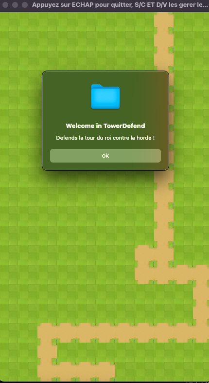
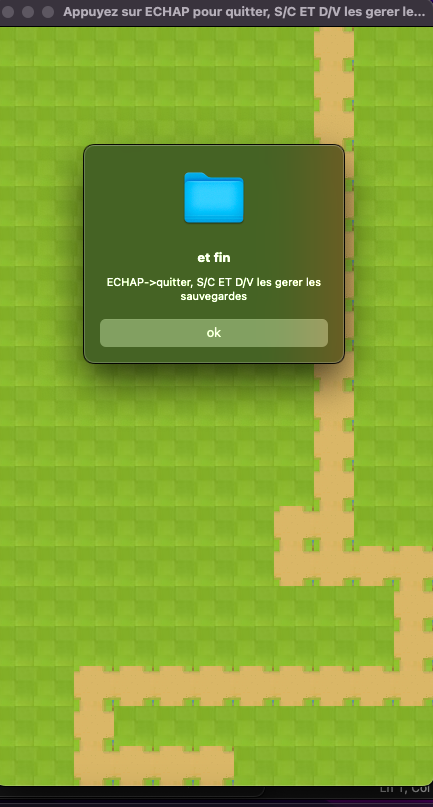
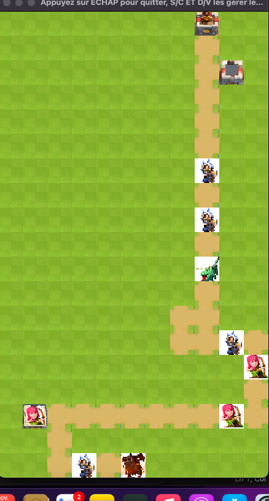

# TowerDefend

Jeu de tower defense en C avec la bibliothèque SDL2, réalisé en binôme dans le cadre du cours de Programmation C (Licence Informatique, Poitiers). Des tours posées sur le plateau défendent la tour du roi contre des unités ennemies qui avancent le long d'un chemin. Le projet utilise des listes chaînées pour gérer les unités, et propose une sauvegarde et un chargement de la partie en binaire et en texte.
## Aperçu





## Principe du jeu

Une horde d'ennemis (dragons, chevaliers, archers, gargouilles) avance le long d'un chemin vers la tour du roi. Des tours (tour au sol, tour aérienne) défendent le chemin.Le jeu se termine quand une tour du roi est detruite.

Chaque Unite a ses points de vie,ses dégâts, sa portée et le type de cyble qu'elle peut attaquer(sol, air ou les deux).

## Commandes

| Touche | Action |
|--------|--------|
| V | Sauvegarde binaire |
| C | Chargement de la sauvegarde binaire |
| D | Sauvegarde texte |
| S | Chargement de la sauvegarde texte |
| Échap | Quitter |

## Compilation et lancement

SDL2 pour Windows (MinGW) est fourni dans le dossier `SDL2/`. Les commandes sont à lancer depuis la racine du projet, car le jeu charge ses images depuis `data/`.

### Windows

Avec Code::Blocks : ouvrir `projetTowerDefend.cbp`, compiler puis lancer.

Avec MinGW-w64 (par exemple via MSYS2) en ligne de commande :

```bash
gcc -std=c99 -Wall -pedantic \
    main.c towerdefend.c maSDL.c \
    -o TowerDefend \
    -ISDL2/x86_64-w64-mingw32/include/SDL2 \
    -LSDL2/x86_64-w64-mingw32/lib \
    -lmingw32 -lSDL2main -lSDL2
```

Garder `SDL2.dll` à côté de l'exécutable.

### macOS
```bash : Dans le terminal 
brew install sdl2
gcc -std=c99 -Wall -Wextra -pedantic main.c towerdefend.c maSDL.c -o TowerDefend  $(sdl2-config --cflags --libs) 
./TowerDefend
```

### Linux
```bash : Dans le terminal 
sudo apt install libsdl2-dev
gcc -std=c99 -Wall -Wextra -pedantic main.c towerdefend.c maSDL.c -o TowerDefend  $(sdl2-config --cflags --libs) 
./TowerDefend
```


## Organisation du code

- `main.c` : boucle principale du jeu et gestion des touches
- `towerdefend.c` / `towerdefend.h` : unités, listes chaînées, combat, déplacement, sauvegardes
- `maSDL.c` / `maSDL.h` : surcouche SDL pour l'affichage (fournie dans le cadre du cours)

## Auteurs

Barry Salimatou, Delice Elif